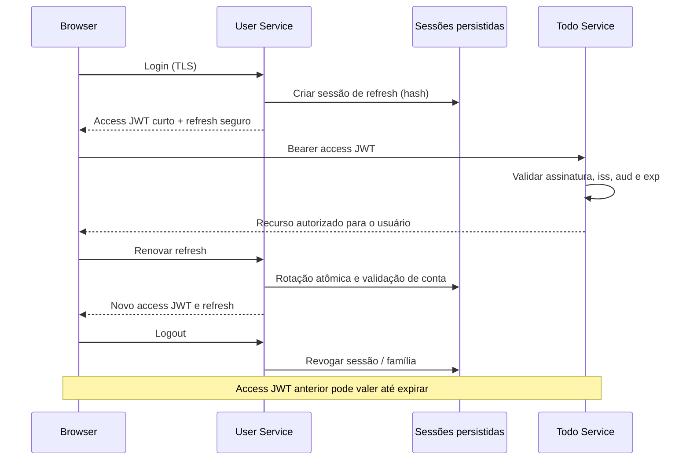

# ADR-0002 — Autenticação e revogação entre microsserviços

> **Estado atual (novembro de 2026).** Este ADR preserva as etapas históricas abaixo; cada seção de progresso descreve o estado **na época** e não deve ser lida como diagnóstico atual. O modo HTTPS opt-in já oferece login, refresh rotativo persistido em PostgreSQL, logout da família de refresh, cookie seguro, verificação Origin/CSRF e coordenação entre abas. O User Service também emite JWTs RS256 no modo opcional (PR #51), validados somente com chave pública no Todo Service. O access JWT permanece com **24 horas por padrão**, embora 15 minutos sejam testados no CI em modo opt-in (PR #50). **Não há revogação imediata distribuída, rotação automática de chaves nem rollout por `kid`/JWKS**. O modo legado segue disponível. Consulte [sessão HTTPS](BROWSER_SESSION_LOCAL_DEMO.md) e [segurança JWT](JWT_SECURITY.md).

**Status:** Proposto para implementação incremental; nenhuma política de revogação distribuída foi implantada.

## Estado de implementação resumido

| Item | Situação |
| --- | --- |
| Assinatura HMAC legada | Implementada como padrão |
| RS256 e validação somente com chave pública no Todo Service | Implementados **por configuração opcional**, sem fallback HMAC |
| Refresh opaco rotativo e logout da família | Implementados no fluxo HTTP opt-in; testes com PostgreSQL e browser |
| Access JWT de curta duração | Configurável; 15 minutos exercitados no CI; **24 horas continuam padrão** |
| Operações do Todo Service durante falha do User Service | Testadas com JWT previamente emitido |
| Revogação imediata de access tokens nos dois serviços | **Não implementada** |
| Rotação de chaves, `kid` e JWKS | **Não implementados** |

O status **proposto** refere-se especificamente à política de revogação distribuída, não ao refresh HTTP ou ao suporte opcional a RS256 que já foram implementados. As opções e critérios abaixo são registros de decisão, não anúncios de funcionalidade pronta.

## Contexto observado no código

- O **User Service** autentica credenciais e emite JWTs HMAC por padrão ou RS256 opcional, com expiração padrão de **86.400.000 ms (24 horas)**. Quando recebe um JWT de acesso, consulta o usuário e recusa contas excluídas/desativadas.
- O **Todo Service** valida localmente assinatura e expiração: no HMAC legado usa o mesmo `JWT_SECRET`; no RS256 usa somente a chave pública. Não consulta o estado cadastral em cada requisição.
- O browser armazena o bearer token em `localStorage`, por meio de Zustand `persist`. A verificação de `exp` no frontend é somente uma conveniência: **o servidor decide a autorização**.
- O **logout atual** elimina o token do browser, mas não invalida cópias existentes. Uma conta desativada pode continuar acessando o Todo Service até a expiração.
- O Redis existe no Docker Compose, mas não há evidência de uso dele como estado de sessão/revogação.

**Problema:** separar a validação criptográfica da identidade de sua autorização *atual*, com um comportamento de segurança explícito mesmo na indisponibilidade da infraestrutura.

## Opções consideradas

| Opção | Latência/custo de requisição | Revogação | Disponibilidade | Considerações |
| --- | --- | --- | --- | --- |
| A — Consulta síncrona ao User Service para cada requisição | Uma chamada remota adicional por operação | Efetiva assim que a conta é desativada, se a consulta responde | Todo Service fica dependente da disponibilidade do User Service | Evita estado replicado, mas aumenta acoplamento, falhas em cascata e custo |
| B — JWT de curta duração, sem refresh | Validação local rápida | Apenas ao expirar (janela de exposição) | Boa independência entre serviços | UX pior: login frequente; **não é revogação imediata** |
| C — JWT curto + refresh token rotativo, armazenado no servidor | Validação local do access token; chamada apenas na renovação | Revogar refresh bloqueia novas emissões; access tokens emitidos continuam válidos até `exp` | Todo Service independente nas requisições usuais | Reduz a janela de exposição; exige armazenamento, rotação atômica e detecção de reutilização |
| D — Estado de revogação/versão de sessão em Redis | Leitura Redis ou cache por operação | Quase imediata, limitada por TTL/replicação/cache e propagação | Redis vira dependência; política para falhas precisa ser definida | Útil quando o requisito de revogação mais rápida justifica a complexidade |

## Proposta para este portfólio

**Adotar C como primeira evolução, com D apenas após requisitos mensuráveis de revogação imediata.** Esta é uma proposta de arquitetura para orientar PRs, não um anúncio de funcionalidade pronta.

1. **Access token curto:** parametrizar o tempo de vida e propor **5 a 15 minutos** (valor a decidir via testes e requisitos). Validar assinatura, `exp`, `iss` e `aud` em ambos os serviços. Migrar emissores/consumidores e os testes E2E no mesmo rollout; preservar compatibilidade controlada com tokens legados até sua expiração, se houver sessões ativas.
2. **Refresh token opaco e rotativo:** token aleatório de alta entropia, persistido **somente como hash** em armazenamento controlado pelo User Service. Definir entidade de sessão, validade absoluta, identificador, versão e metadados mínimos; impedir renovação de usuários desativados/excluídos. Cada renovação deve invalidar o refresh anterior **atomicamente**, detectando reutilização e revogando sua família.
3. **Transporte web:** avaliar cookie `HttpOnly; Secure; SameSite` no domínio do backend/gateway para refresh, com `Path` restrito e proteção CSRF conforme topologia/origem. Preferir manter o access token em memória no browser. Não reutilizar automaticamente a configuração atual de CORS/CSRF: o backend precisa de revisão específica.
4. **Logout:** invalidar a sessão de refresh no servidor e apagar credenciais locais. Registrar que um access token já emitido permanece utilizável até expirar, salvo adoção de D.
5. **Revogação distribuída (D), se necessária:** definir `sessionId`/`jti` e modelo de revogação ou `tokenVersion` por conta. Uma lista de negação em Redis deve ter TTL no máximo igual à vida restante do token; considerar persistência durável como fonte de verdade, atomicidade, invalidação e sincronização. **Não usar somente pub/sub** como fonte de verdade: mensagens podem ser perdidas.
6. **Política de falha:** para endpoints protegidos que exigem revogação imediata, escolher explicitamente **fail-closed** quando não é possível confirmar estado; caso contrário, reconhecer e documentar o risco de `fail-open`. Medir disponibilidade e impacto do Redis antes de habilitar a verificação em todo request.
7. **Gestão de chaves:** o compartilhamento de `JWT_SECRET` HS256 permite que qualquer serviço que conheça a chave também assine tokens. Avaliar migração para emissor assimétrico com chaves públicas no Todo Service, rotação e identificação de chave (`kid`), sem aceitar algoritmo informado pelo atacante sem lista permitida.

## Fluxo-alvo (proposto, não implementado)

O desenho retrata o fluxo desejado com access JWT curto; o fluxo opcional já implementa cookie, endpoint HTTP e persistência de sessão, mas ainda **não adota access JWT curto por padrão**.

## Critérios de aceitação para a implementação

- [ ] Tokens emitidos têm TTL configurável, `iss`, `aud` e algoritmo explicitamente esperado; ambos os microsserviços rejeitam tokens expirados, com emissor/audiência errados ou assinatura inválida.
- [ ] Refresh token aleatório é armazenado somente como hash e rotacionado atomicamente; replay do token anterior não cria nova sessão.
- [ ] Desativar ou excluir a conta impede emissão e refresh em User Service.
- [ ] Logout revoga refresh no servidor; o comportamento do access token remanescente é documentado e testado.
- [ ] Testes unitários e E2E cobrem expiração, rotação, reuso, logout, conta desativada e indisponibilidade da infraestrutura escolhida.
- [ ] Nenhum token/segredo aparece em logs, exceções ou atributos de tracing.
- [ ] Escolha de `localStorage` versus cookies/memória, CSRF, CORS e HTTPS documentada com consequências.
- [ ] Caso D seja exigida: testes de `fail-closed` e de indisponibilidade do Redis, latência p95, TTL e comportamento ao reiniciar os contêineres.

## Consequências e riscos

- A alternativa C reduz a janela em que a desativação não surte efeito no Todo Service; **não elimina** essa janela.
- A alternativa D pode reduzir essa janela, mas introduz dependência operacional. O Redis atual do Compose não é, por si só, uma solução implementada de revogação.
- Diminuir o TTL atual de 24h sem antes construir um fluxo de renovação causaria expiração frequente da sessão do usuário. Portanto, **não aplicar essa mudança isoladamente**.
- Evoluir sem necessidade para introspecção síncrona em todo request tornaria o projeto menos resiliente.

## Referências internas

- [ADR-0001: sessões web e visibilidade de perfis](ADR-0001-web-session-and-profile-visibility.md)
- [Arquitetura atual](ARCHITECTURE.md)
- [Issue #6 — segurança de autenticação](https://github.com/danmaciel/monorepo_sistema_todo_com_microservices/issues/6)

## Progresso de implementação — modelo isolado (etapa 1)

Foi criada uma implementação **sem integração** com material opaco de 256 bits, fingerprint SHA-256 e um registro de domínio imutável para sessão, com testes unitários. Ela ainda **não** grava no PostgreSQL, não implementa endpoints, não emite refresh token no login, não realiza rotação nem garante revogação entre serviços. Veja [Modelo de sessão de refresh](REFRESH_TOKEN_DESIGN.md). O status do ADR permanece **proposto** até a validação do fluxo de ponta a ponta.

## Progresso — banco e consumo único (etapa 2)

Foi adicionada uma migração Flyway para a tabela de sessões e um repositório JDBC que persiste somente fingerprints SHA-256 e consome tokens por `UPDATE` condicional atômico. Testes com PostgreSQL via Testcontainers verificam o comportamento de duas requisições concorrentes. **Isto ainda não implementa rotação transacional completa, HTTP refresh/logout, invalidação de família ou renovação no frontend.** Leia [documentação de persistência e concorrência](REFRESH_TOKEN_PERSISTENCE.md).

## Progresso — rotação transacional interna (etapa 3)

O `RefreshSessionRotationService` agora usa uma única transação JDBC para reivindicar o token anterior por `UPDATE ... RETURNING` e inserir seu sucessor. Os testes com PostgreSQL verificam que duas tentativas simultâneas produzem no máximo um sucessor, que a expiração absoluta/família são preservadas e que falha de inserção provoca rollback. O novo segredo só é devolvido ao chamador interno após o COMMIT. **Ainda não há endpoint de refresh, emissão no login, verificação de conta ativa na rotação, proteção de replay por família nem integração web**, portanto não existe uma solução de renovação de sessões utilizável por clientes. Veja [Persistência e concorrência](REFRESH_TOKEN_PERSISTENCE.md).

## Progresso — verificação da conta na rotação (etapa 4)

A rotação interna agora só pode consumir uma sessão se houver uma conta `users` existente e `enabled = TRUE`. O `UPDATE` condicional inclui um `EXISTS ... FOR SHARE`, que serializa a verificação contra mudanças concorrentes no registro do usuário. Testes PostgreSQL confirmam que contas desativadas ou excluídas não recebem sucessores e que a recusa não consome o token original. **Esta etapa ainda não expõe refresh/logout HTTP, não revoga JWTs de acesso existentes no Todo Service e não resolve a política de replay e invalidação de famílias.**

## Progresso — resposta a replay no armazenamento de refresh (etapa 5)

Quando a rotação interna recebe um token **já consumido, ainda não expirado e não previamente revogado**, a família de refresh sessions é revogada no PostgreSQL. Testes com PostgreSQL exercitam o sucessor, o isolamento entre famílias, tokens desconhecidos, revogados e expirados. A política é conservadora: retries após perda de resposta e concorrência entre abas podem revogar uma sessão legítima; o cliente deverá coordenar renovações, e o contrato HTTP deverá estabelecer como tratar falhas de rede. **Não existem endpoints HTTP de refresh/logout, nem revogação dos access JWTs previamente emitidos no Todo Service.** Veja [persistência de refresh](REFRESH_TOKEN_PERSISTENCE.md).
