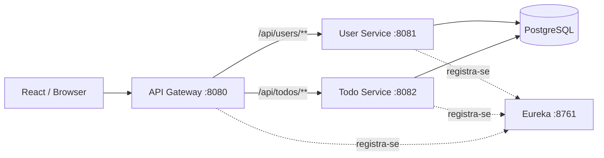

# Arquitetura e decisões técnicas

Este repositório é uma **demonstração de microsserviços**, não uma implantação de produção.

## Visão geral



O Gateway faz **roteamento estático por hostname/porta no Docker Compose**, embora os serviços se registrem no Eureka. Portanto, não se deve anunciar balanceamento dinâmico via service discovery como funcionalidade já implementada. O Redis está definido no Compose, mas o código inspecionado não evidencia integração de cache na aplicação.

## Autenticação e autorização

1. O User Service valida credenciais e emite um JWT assinado.
2. O frontend envia `Authorization: Bearer <token>`.
3. O Todo Service valida a assinatura com o mesmo `JWT_SECRET` e extrai o identificador do usuário.
4. A camada de serviço verifica o proprietário da tarefa antes das operações individuais.

Os dois serviços precisam receber o mesmo segredo forte. Um segredo simétrico compartilhado é simples para estudo, mas aumenta o impacto de vazamento. Em sistemas reais, avaliar assinatura assimétrica, emissor/audiência, rotação de chaves e validação centralizada.

## Persistência e isolamento

O Compose utiliza **um PostgreSQL compartilhado** e a mesma base `tododb` para User Service e Todo Service. Isso simplifica o ambiente, mas não oferece isolamento de dados ou autonomia de evolução do esquema entre serviços. Em um sistema evolutivo, estudar separação de schemas ou bancos por serviço, migrações controladas e contratos de integração.

## Observabilidade e resiliência

- Spring Boot Actuator expõe os endpoints de saúde e informação configurados.
- Ainda não há evidência de tracing distribuído, métricas centralizadas, circuit breakers ou testes de falha entre serviços.
- Os testes de serviço são unitários e usam mocks; **não substituem** testes com PostgreSQL nem testes ponta a ponta via Gateway.

## Configuração segura

Use `POSTGRES_PASSWORD` e `JWT_SECRET` fortes para Docker. Para execução Java fora do Docker, configure `DB_PASSWORD` e `JWT_SECRET`; `DB_URL` e `DB_USERNAME` são opcionais e possuem valores locais de desenvolvimento.

Exemplo em terminal, sem publicar os valores no Git:

```bash
export DB_PASSWORD='<senha-local>'
export JWT_SECRET='<segredo-aleatorio-com-pelo-menos-32-bytes>'
```

O arquivo `.env.example` traz o modelo para Compose. Não coloque segredos em `application.yml` nem em commits.

CORS no Gateway está limitado às origens locais `http://localhost:3000` e `http://localhost:5173`. Uma implantação com domínio próprio precisa definir explicitamente suas origens autorizadas.

## Próximas melhorias recomendadas

- Teste de integração HTTP com Gateway, User Service, Todo Service e PostgreSQL.
- Separar dados dos serviços e introduzir Flyway ou Liquibase.
- Migrar segredos e configuração de produção para gerenciador de segredos.
- Centralizar logs e adicionar tracing OpenTelemetry.
- Revisar autenticação com chaves assimétricas e autorização baseada em políticas.
