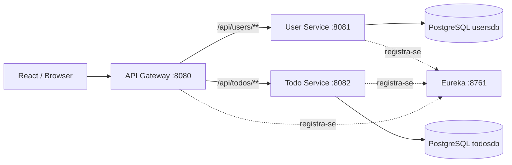

# Arquitetura e decisões técnicas

Este repositório é uma **demonstração de microsserviços**, não uma implantação de produção.

## Visão geral



O Gateway faz **roteamento estático por hostname/porta no Docker Compose**, embora os serviços se registrem no Eureka. Portanto, não se deve anunciar balanceamento dinâmico via service discovery como funcionalidade já implementada. O Redis está definido no Compose, mas o código inspecionado não evidencia integração de cache na aplicação.

## Autenticação e autorização

1. O User Service valida credenciais e emite um JWT assinado (fluxo padrão); o fluxo HTTP de refresh é habilitado apenas por configuração explícita.
2. O frontend envia `Authorization: Bearer <token>`.
3. O Todo Service valida localmente assinatura, expiração, emissor e audiência, extraindo o identificador do usuário. No HMAC legado usa o mesmo `JWT_SECRET`; no RS256 opcional recebe **apenas a chave pública**.
4. A camada de serviço verifica o proprietário da tarefa antes das operações individuais.

O modo padrão mantém HMAC com segredo compartilhado, que também dá ao Todo Service capacidade criptográfica de assinar tokens. O modo RS256 opcional (PR #51) separa emissão e verificação: a chave privada fica no User Service e somente a pública é fornecida ao Todo Service. **Não há fallback entre famílias de algoritmos** durante a execução; uma troca de modo exige cuidado com tokens previamente emitidos. A rotação automática de chaves e o uso de `kid` ainda não foram implementados. Emissor e audiência são validados, com compatibilidade opcional para JWTs antigos sem essas claims.

**Sessões e revogação:** o access token dura 24 horas por padrão (TTL parametrizável no User Service). O modo HTTP de sessão é opcional e desabilitado por padrão: ele fornece refresh rotativo, cookie HttpOnly e CSRF/Origin, com coordenação Web Locks em abas da mesma origem. O User Service recusa JWT de usuário desativado, mas o Todo Service valida JWT localmente e ainda pode autorizá-lo até expirar. **Não há revogação imediata distribuída de access JWTs nem Redis integrado para esse fim.** Ver [ADR-0002](ADR-0002-distributed-token-revocation.md) e [demonstração HTTPS](BROWSER_SESSION_LOCAL_DEMO.md).

## Persistência e isolamento

O Compose utiliza **duas instâncias PostgreSQL isoladas**: User Service é dono de `usersdb` (`users`, `refresh_sessions`) e Todo Service é dono de `todosdb` (`todos`). Cada banco possui seu próprio volume, usuário e senha. Cada serviço aplica suas migrações Flyway e o Hibernate apenas valida o esquema (`ddl-auto=validate`). Não há consulta SQL cruzada ou chave estrangeira entre serviços. A associação da tarefa ao usuário é representada apenas pelo UUID; políticas distribuídas de exclusão de usuário, sincronização e consistência eventual continuam fora do escopo. Consulte [plano de migração](DATABASE_SCHEMA_MIGRATION_PLAN.md).

## Observabilidade e resiliência

- Spring Boot Actuator expõe os endpoints de saúde e informação configurados.
- Tracing distribuído já está implementado no Gateway, User Service e Todo Service, exportando spans para o Zipkin. Consulte [o guia de tracing](TRACING.md).
- O workflow [Docker Compose E2E](../.github/workflows/e2e.yml) executa cadastro, login, operações com tarefas, testes de autorização entre usuários e verifica a presença de spans no Zipkin.
- O mesmo workflow utiliza RS256 com chaves efêmeras, valida assinatura e rejeita tokens HMAC nesse modo, testa refresh com JWT de 15 minutos e mantém o cenário de interrupção controlada do User Service.
- Os testes Java unitários usam mocks; o E2E usa PostgreSQL real via Compose, mas isso não substitui testes de carga, resiliência ou migração. Ainda não há circuit breakers, retries controlados ou observabilidade completa de produção.

## Tolerância à indisponibilidade do User Service

O Todo Service valida a assinatura e as claims de access JWTs **localmente**, com segredo compartilhado no modo HMAC ou com a chave pública no modo RS256, e acessa apenas seu próprio banco de dados. **Não consulta o User Service a cada operação de tarefa.** Assim, operações de tarefas com JWT válido e já emitido podem continuar mesmo quando o User Service estiver fora do ar, desde que Gateway, Todo Service e banco de tarefas estejam disponíveis.

O teste `scripts/e2e_user_service_outage.py`, executado pelo workflow Docker Compose E2E, registra duas contas, interrompe o User Service e verifica leitura, criação, alteração e exclusão de tarefas, incluindo a recusa de acesso cruzado. O serviço é reiniciado ao final do teste. O teste cobre uma indisponibilidade controlada, não uma falha de rede prolongada ou um cenário de carga.

**Limitação de segurança:** como o Todo Service não verifica o estado atual da conta nem consulta revogação distribuída, um JWT já emitido pode continuar válido após desativação de usuário ou logout até sua expiração. O modo padrão ainda utiliza tokens de 24 horas; isso exige uma decisão explícita de segurança antes de implantação real. Não adicione retries/circuit breakers a chamadas síncronas do User Service que não existem no fluxo atual.

## Configuração segura

Use `USER_DB_PASSWORD` e `TODO_DB_PASSWORD` fortes e distintos para Docker. No modo HMAC legado, configure também `JWT_SECRET` forte e compartilhado pelos serviços; em RS256, use `JWT_RSA_PRIVATE_KEY_BASE64` e `JWT_RSA_PUBLIC_KEY_BASE64` no User Service e somente a variável pública no Todo Service. Para execução Java fora do Docker, configure separadamente `DB_PASSWORD`, `DB_URL`, `DB_USERNAME` e a modalidade de JWT escolhida.

Exemplo em terminal, sem publicar os valores no Git:

```bash
export DB_URL='jdbc:postgresql://localhost:5432/usersdb' # User Service; para Todo use localhost:5433/todosdb
export DB_USERNAME='users_app' # para Todo use todos_app
export DB_PASSWORD='<senha-do-servico>'
export JWT_SECRET='<segredo-aleatorio-com-pelo-menos-32-bytes>'
```

O arquivo `.env.example` traz o modelo para Compose. Não coloque segredos em `application.yml` nem em commits.

CORS no Gateway e no Todo Service está limitado às origens locais `http://localhost:3000` e `http://localhost:5173`. Uma implantação com domínio próprio precisa definir explicitamente suas origens autorizadas. CORS restringe o acesso de navegadores e **não** substitui autenticação, autorização ou controles de rede; clientes não-navegador podem acessar serviços diretamente se estiverem expostos.

## Próximas melhorias recomendadas

- Expandir testes de resiliência controlada para falhas de banco, tempo de recuperação e políticas explícitas de indisponibilidade, sem confundir o E2E atual com testes de alta disponibilidade.
- Estudar comunicação assíncrona, consistência eventual e políticas para referências de usuários em tarefas; validar migrações de bancos legados antes de qualquer rollout externo.
- Migrar segredos e configuração de produção para gerenciador de segredos.
- Evoluir logs estruturados, métricas, alertas e correlação com os traces já implementados.
- Avaliar rotação de chaves RSA com `kid`/JWKS e estratégia de migração; revisar autorização baseada em políticas e revogação distribuída se surgirem requisitos concretos.
