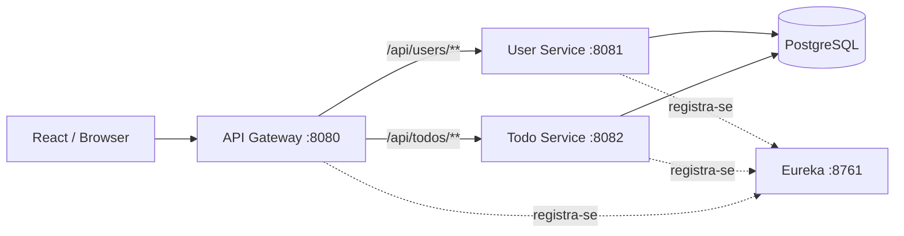

# Arquitetura e decisões técnicas

Este repositório é uma **demonstração de microsserviços**, não uma implantação de produção.

## Visão geral



O Gateway faz **roteamento estático por hostname/porta no Docker Compose**, embora os serviços se registrem no Eureka. Portanto, não se deve anunciar balanceamento dinâmico via service discovery como funcionalidade já implementada. O Redis está definido no Compose, mas o código inspecionado não evidencia integração de cache na aplicação.

## Autenticação e autorização

1. O User Service valida credenciais e emite um JWT assinado (fluxo padrão); o fluxo HTTP de refresh é habilitado apenas por configuração explícita.
2. O frontend envia `Authorization: Bearer <token>`.
3. O Todo Service valida a assinatura com o mesmo `JWT_SECRET` e extrai o identificador do usuário.
4. A camada de serviço verifica o proprietário da tarefa antes das operações individuais.

Os dois serviços precisam receber o mesmo segredo forte. Um segredo simétrico compartilhado é simples para estudo, mas aumenta o impacto de vazamento. Em sistemas reais, avaliar assinatura assimétrica, rotação de chaves e requisitos de validação/estado de sessão. Os validadores já verificam emissor e audiência, com compatibilidade opcional para JWTs antigos sem essas claims.

**Sessões e revogação:** o access token dura 24 horas por padrão (TTL parametrizável no User Service). O modo HTTP de sessão é opcional e desabilitado por padrão: ele fornece refresh rotativo, cookie HttpOnly e CSRF/Origin, com coordenação Web Locks em abas da mesma origem. O User Service recusa JWT de usuário desativado, mas o Todo Service valida JWT localmente e ainda pode autorizá-lo até expirar. **Não há revogação imediata distribuída de access JWTs nem Redis integrado para esse fim.** Ver [ADR-0002](ADR-0002-distributed-token-revocation.md) e [demonstração HTTPS](BROWSER_SESSION_LOCAL_DEMO.md).

## Persistência e isolamento

O Compose utiliza **um PostgreSQL compartilhado** e a mesma base `tododb` para User Service e Todo Service. Isso simplifica o ambiente, mas não oferece isolamento de dados ou autonomia de evolução do esquema entre serviços. Em um sistema evolutivo, estudar separação de schemas ou bancos por serviço, migrações controladas e contratos de integração.

## Observabilidade e resiliência

- Spring Boot Actuator expõe os endpoints de saúde e informação configurados.
- Tracing distribuído já está implementado no Gateway, User Service e Todo Service, exportando spans para o Zipkin. Consulte [o guia de tracing](TRACING.md).
- O workflow [Docker Compose E2E](../.github/workflows/e2e.yml) executa cadastro, login, operações com tarefas, testes de autorização entre usuários e verifica a presença de spans no Zipkin.
- Os testes Java unitários usam mocks; o E2E usa PostgreSQL real via Compose, mas isso não substitui testes de carga, resiliência ou migração. Ainda não há circuit breakers, retries controlados ou observabilidade completa de produção.

## Configuração segura

Use `POSTGRES_PASSWORD` e `JWT_SECRET` fortes para Docker. Para execução Java fora do Docker, configure `DB_PASSWORD` e `JWT_SECRET`; `DB_URL` e `DB_USERNAME` são opcionais e possuem valores locais de desenvolvimento.

Exemplo em terminal, sem publicar os valores no Git:

```bash
export DB_PASSWORD='<senha-local>'
export JWT_SECRET='<segredo-aleatorio-com-pelo-menos-32-bytes>'
```

O arquivo `.env.example` traz o modelo para Compose. Não coloque segredos em `application.yml` nem em commits.

CORS no Gateway e no Todo Service está limitado às origens locais `http://localhost:3000` e `http://localhost:5173`. Uma implantação com domínio próprio precisa definir explicitamente suas origens autorizadas. CORS restringe o acesso de navegadores e **não** substitui autenticação, autorização ou controles de rede; clientes não-navegador podem acessar serviços diretamente se estiverem expostos.

## Próximas melhorias recomendadas

- Ampliar o E2E existente com cenários de indisponibilidade, expiração de token e contratos entre serviços.
- Separar os dados de cada serviço e estender as migrações Flyway do User Service para substituir gradualmente o `ddl-auto: update`.
- Migrar segredos e configuração de produção para gerenciador de segredos.
- Evoluir logs estruturados, métricas, alertas e correlação com os traces já implementados.
- Revisar autenticação com chaves assimétricas e autorização baseada em políticas.
