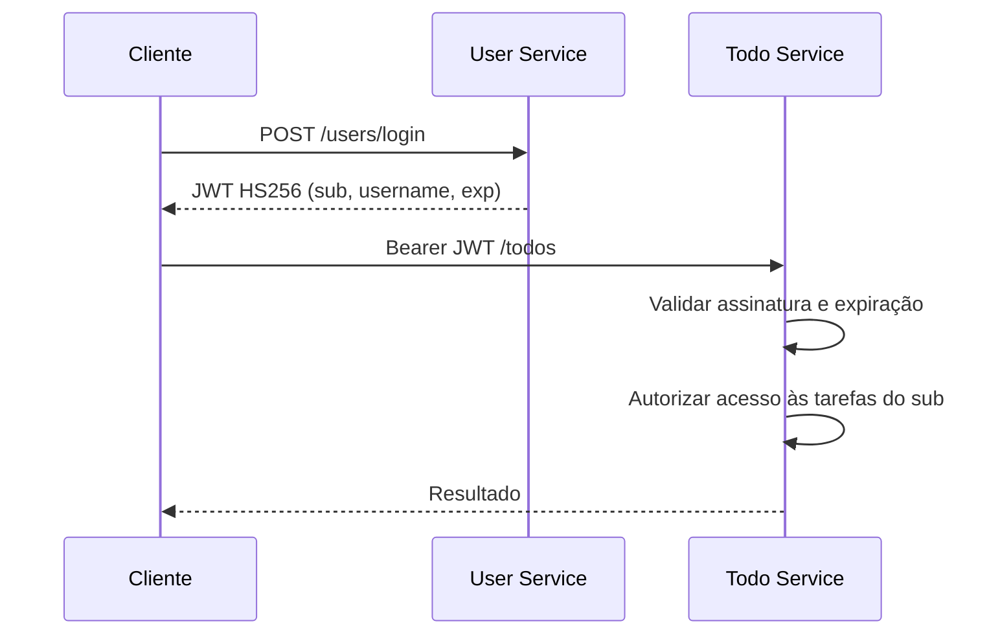

# Validação de JWT e limites de autorização

## Escopo implementado

O User Service autentica credenciais e emite JWTs assinados com HS256. Os tokens contêm o UUID do usuário (`sub`), o nome de usuário e a expiração, configurada atualmente em 24 horas. O Todo Service valida localmente assinatura e validade e usa o `sub` para aplicar as regras de propriedade das tarefas.

O User Service consulta o cadastro em requisições autenticadas e recusa contas desativadas ou excluídas. O Todo Service **não** consulta o estado cadastral a cada requisição: um JWT ainda válido pode continuar autorizando tarefas após a desativação da conta.

A validação de assinatura e expiração **não equivale** a revogação. `iss` (emissor), `aud` (destinatário), revogação distribuída e refresh tokens ativos ainda não fazem parte do contrato HTTP de autenticação. O JWT é assinado, **não criptografado**: dados sensíveis não devem ser incluídos em suas claims.

## Fluxo atual



O segredo simétrico compartilhado simplifica o laboratório, mas qualquer serviço que possua esse segredo também tem capacidade de emitir assinaturas. A adoção futura de chave assimétrica, rotação e validação explícita de emissor e destinatário exige migração compatível e testes em ambos os serviços.

## Evidências automatizadas

| Comportamento | Onde verificar |
| --- | --- |
| Emissão de JWT e extração da identidade | `user-service/.../JwtTokenProviderContractTest.java` |
| Rejeição de assinatura incorreta e token expirado | `JwtTokenProviderContractTest` nos dois serviços |
| Rejeição de conta desativada/excluída no User Service | `JwtAuthenticationFilterTest` |
| Expiração de JWT assinado verificada via Gateway | `scripts/e2e_gateway.py` |
| Autorização de tarefas por proprietário | `todo-service/.../TodoServiceTest.java` |

Execute na raiz do monorepo:

```bash
mvn -f packages/user-service/pom.xml -Dtest=JwtTokenProviderContractTest test
mvn -f packages/todo-service/pom.xml -Dtest=JwtTokenProviderContractTest test
```

Os testes utilizam credenciais fictícias. A aprovação do CI demonstra os cenários cobertos, não certifica segurança absoluta ou validação em produção.

## Limitações e decisões em aberto

- O frontend mantém o bearer token no `localStorage`, que é acessível por scripts na mesma origem em caso de XSS.
- Logout limpa o estado local, mas não invalida tokens já emitidos no Todo Service.
- `iss` e `aud` ainda não são verificados pelos providers; sua inclusão é uma evolução de contrato, não uma funcionalidade atual.
- A tabela de sessões de refresh e o consumo único de fingerprint já existem, mas não estão conectados à autenticação HTTP.

Consulte [ADR-0001 — Sessão web e perfis](ADR-0001-web-session-and-profile-visibility.md) e [ADR-0002 — Revogação distribuída](ADR-0002-distributed-token-revocation.md). A evolução é rastreada na [Issue #11](https://github.com/danmaciel/monorepo_sistema_todo_com_microservices/issues/11).
