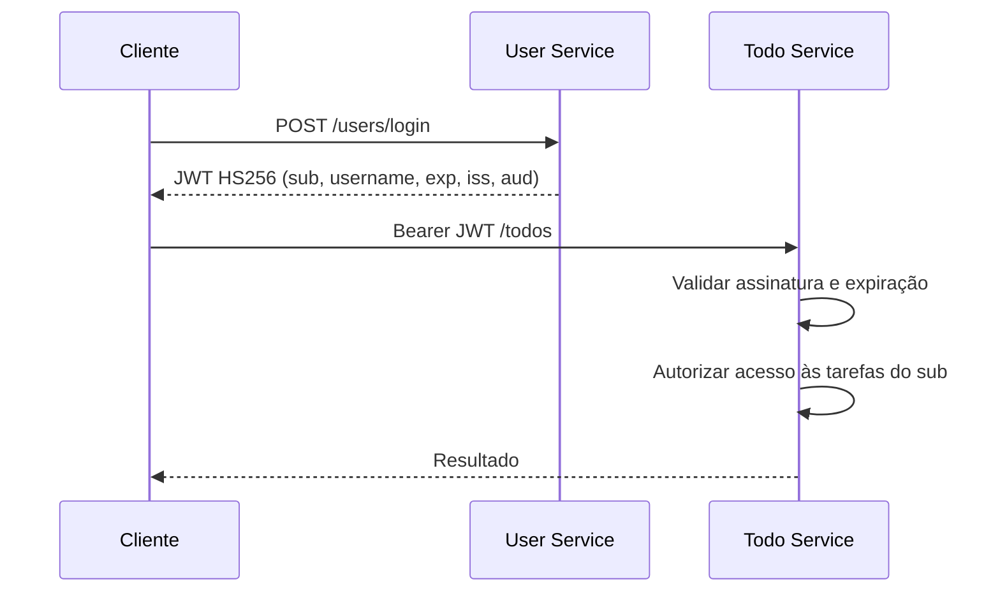

# Validação de JWT e limites de autorização

## Escopo implementado

O User Service autentica credenciais e emite JWTs assinados com HS256. Os novos tokens contêm o UUID do usuário (`sub`), o nome de usuário, a expiração (24 horas por padrão, configurável pelo User Service), o emissor `iss=todo-user-service` e a audiência `aud=todo-api`. User Service e Todo Service validam a assinatura, rejeitam tokens expirados e exigem as claims `exp` e `sub` (UUID válido). O Todo Service usa esse `sub` para aplicar as regras de propriedade das tarefas. **Os dois validadores agora rejeitam `iss` ou `aud` incompatíveis** com o contrato `todo-user-service` / `todo-api`. Durante a transição, tokens legados que não possuem *nenhuma das duas claims* continuam aceitos se estiverem corretamente assinados e não expirados. Tokens que apresentam somente uma das claims são rejeitados. Essa compatibilidade é controlada por `JWT_ACCEPT_LEGACY_WITHOUT_CLAIMS` (padrão `true`) em **ambos** os serviços; com `false`, `iss` e `aud` passam a ser obrigatórios. Isso não implementa revogação ou gestão de sessões.

O User Service consulta o cadastro em requisições autenticadas e recusa contas desativadas ou excluídas. O Todo Service **não** consulta o estado cadastral a cada requisição: um JWT ainda válido pode continuar autorizando tarefas após a desativação da conta.

A validação de assinatura e expiração **não equivale** a revogação. `iss` (emissor) e `aud` (destinatário) são emitidos e conferidos quando presentes. Exigi-los para todos os tokens depende de desativar o modo legado em ambos os serviços após expirar o último JWT antigo. O modo opcional de sessão web já expõe login, refresh e logout por HTTP com rotação e proteção de Origin/CSRF; ele não oferece revogação imediata dos access JWTs em outros serviços. Consulte [Demonstração local de sessão web](BROWSER_SESSION_LOCAL_DEMO.md). O JWT é assinado, **não criptografado**: dados sensíveis não devem ser incluídos em suas claims.

## Fluxo atual



O segredo simétrico compartilhado simplifica o laboratório, mas qualquer serviço que possua esse segredo também tem capacidade de emitir assinaturas. A adoção futura de chave assimétrica, rotação e validação explícita de emissor e destinatário exige migração compatível e testes em ambos os serviços.

## Duração configurável do access JWT

O User Service lê `JWT_ACCESS_EXPIRATION_MS` (em **milissegundos**) e mantém **86400000 (24 horas)** quando a variável não está definida. Exemplo para um ambiente de testes com o fluxo de refresh habilitado:

```bash
export JWT_ACCESS_EXPIRATION_MS=900000  # 15 minutos
```

A mudança afeta **somente os tokens emitidos depois que o User Service for reiniciado com a nova configuração**; tokens anteriores continuam válidos até seu próprio `exp`. O Todo Service valida a expiração presente no JWT, sem precisar receber essa variável.

No Docker Compose, o perfil `application-docker.yml` do User Service também respeita `JWT_ACCESS_EXPIRATION_MS` (antes era fixado em 24 horas nesse perfil). O workflow Docker Compose E2E inicia o **modo opt-in de refresh** com `JWT_ACCESS_EXPIRATION_MS=900000`, verifica que JWTs emitidos por cadastro, login, login de sessão e refresh têm validade de 15 minutos e exercita os fluxos normais de autenticação e de navegador. Isso testa a configuração; o padrão do Compose continua em 24 horas e os access tokens não são revogados imediatamente após logout.

**Não reduza o TTL no fluxo legado isoladamente.** O cliente padrão mantém tokens bearer no `localStorage` e não utiliza a renovação opcional; reduzir o prazo sem migrar esse cliente provoca expirações frequentes e perda de sessão. Validar o modo opt-in, o tratamento de falhas, as abas concorrentes e um plano de rollout/rollback é requisito anterior à adoção de uma duração menor. Este ajuste é apenas de configurabilidade, não uma mudança de política.

## Evidências automatizadas

| Comportamento | Onde verificar |
| --- | --- |
| Emissão de JWT, TTL configurado e extração da identidade | `user-service/.../JwtTokenProviderContractTest.java` |
| Rejeição de assinatura incorreta, token expirado e emissor/audiência incorretos | `JwtTokenProviderContractTest` nos dois serviços |
| Rejeição de conta desativada/excluída no User Service | `JwtAuthenticationFilterTest` |
| Expiração de JWT assinado verificada via Gateway | `scripts/e2e_gateway.py` |
| Autorização de tarefas por proprietário | `todo-service/.../TodoServiceTest.java` |

Execute na raiz do monorepo:

```bash
mvn -f packages/user-service/pom.xml -Dtest=JwtTokenProviderContractTest test
mvn -f packages/todo-service/pom.xml -Dtest=JwtTokenProviderContractTest test
```

Os testes utilizam credenciais fictícias. A aprovação do CI demonstra os cenários cobertos, não certifica segurança absoluta ou validação em produção.

O workflow [Docker Compose E2E](../.github/workflows/e2e.yml) executa os dois serviços em **modo estrito apenas no ambiente descartável de CI**, usando `JWT_ACCEPT_LEGACY_WITHOUT_CLAIMS=false`, e verifica a rejeição de JWTs corretamente assinados sem `iss`/`aud`. O Docker Compose local preserva o padrão `true` para compatibilidade. Essa verificação não significa que o modo estrito tenha sido ativado em instalações existentes.

## Limitações e decisões em aberto

- O frontend mantém o bearer token no `localStorage`, que é acessível por scripts na mesma origem em caso de XSS.
- Logout limpa o estado local, mas não invalida tokens já emitidos no Todo Service.
- O modo de compatibilidade (`JWT_ACCEPT_LEGACY_WITHOUT_CLAIMS=true`) mantém o aceite de tokens antigos sem `iss` e `aud`. **Para exigir ambas as claims**, configure `JWT_ACCEPT_LEGACY_WITHOUT_CLAIMS=false` em User e Todo Service **somente após ao menos 24 horas da implantação de todos os emissores atualizados**, acrescidas de eventual margem de relógio, e confirme que não existem emissores antigos ativos. Se os serviços forem usados fora de um ambiente descartável, planeje e teste o rollout/rollback; não altere isoladamente o TTL de 24 horas.
- A tabela e a rotação de sessões de refresh estão conectadas ao **modo HTTP opt-in**, desabilitado por padrão. O modo padrão mantém a autenticação bearer antiga. O refresh por cookie não invalida imediatamente access JWTs já emitidos; concorrência entre abas e perda da resposta após COMMIT permanecem questões abertas.

Consulte [ADR-0001 — Sessão web e perfis](ADR-0001-web-session-and-profile-visibility.md) e [ADR-0002 — Revogação distribuída](ADR-0002-distributed-token-revocation.md). A evolução é rastreada na [Issue #11](https://github.com/danmaciel/monorepo_sistema_todo_com_microservices/issues/11).
