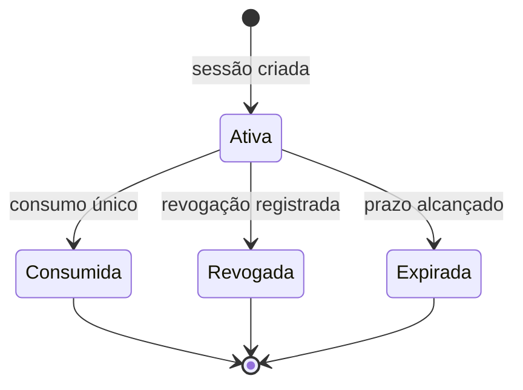

# Modelo de sessão e material de refresh token

## Objetivo

O projeto contém a base para evoluir de um JWT de acesso de 24 horas para access tokens curtos e refresh tokens rotativos. **O login atual ainda não emite refresh tokens**; não existem endpoints de renovação nem integração com cookies ou frontend.

O modelo separa três responsabilidades:

| Componente | Responsabilidade |
| --- | --- |
| `RefreshTokenMaterial` | Gera segredo opaco de 32 bytes com `SecureRandom`, serializa em Base64URL e calcula fingerprint SHA-256 |
| `RefreshSession` | Modelo imutável com identificadores da sessão, usuário e família, fingerprint, expiração e revogação |
| `RefreshSessionStore` | Persiste fingerprint no PostgreSQL e permite consumo único por atualização condicional |

O refresh token original é um segredo apresentado pelo cliente. O banco armazena apenas o fingerprint, evitando exposição direta do valor caso a tabela seja lida indevidamente. SHA-256 é aplicável aqui porque os tokens são gerados com alta entropia; não substitui Argon2id/bcrypt para senhas escolhidas por pessoas.

## Estado e transições



O estado representa os campos disponíveis na persistência. **O fluxo interno já possui rotação transacional e revogação da família quando um token consumido é reutilizado dentro do prazo.** A presença de `family_id` permite essa invalidação, mas ainda não existe um endpoint HTTP de renovação nem um cliente coordenando requisições simultâneas.

## Requisitos para a evolução

A rotação interna já consome o token anterior e registra o sucessor **na mesma transação**, verificando contas ativas. A reutilização do anterior provoca revogação da família. Ainda será necessário definir a política operacional de múltiplas abas, perdas de resposta, renovações HTTP, logout e expiração curta do access JWT.

O eventual transporte via cookie `HttpOnly; Secure; SameSite` requer projeto de CORS, CSRF, domínio e HTTPS. Não deve ser ativado apenas por adicionar o atributo do cookie.

## Testes e referências

```bash
mvn -f packages/user-service/pom.xml -Dtest=RefreshSessionTest test
mvn -f packages/user-service/pom.xml -Dtest=RefreshSessionStoreTest test
```

O segundo comando requer Docker para o PostgreSQL do Testcontainers. Consulte [REFRESH_TOKEN_PERSISTENCE.md](REFRESH_TOKEN_PERSISTENCE.md) para os invariantes SQL e testes de concorrência, e [ADR-0002](ADR-0002-distributed-token-revocation.md) para a avaliação de estratégias.
