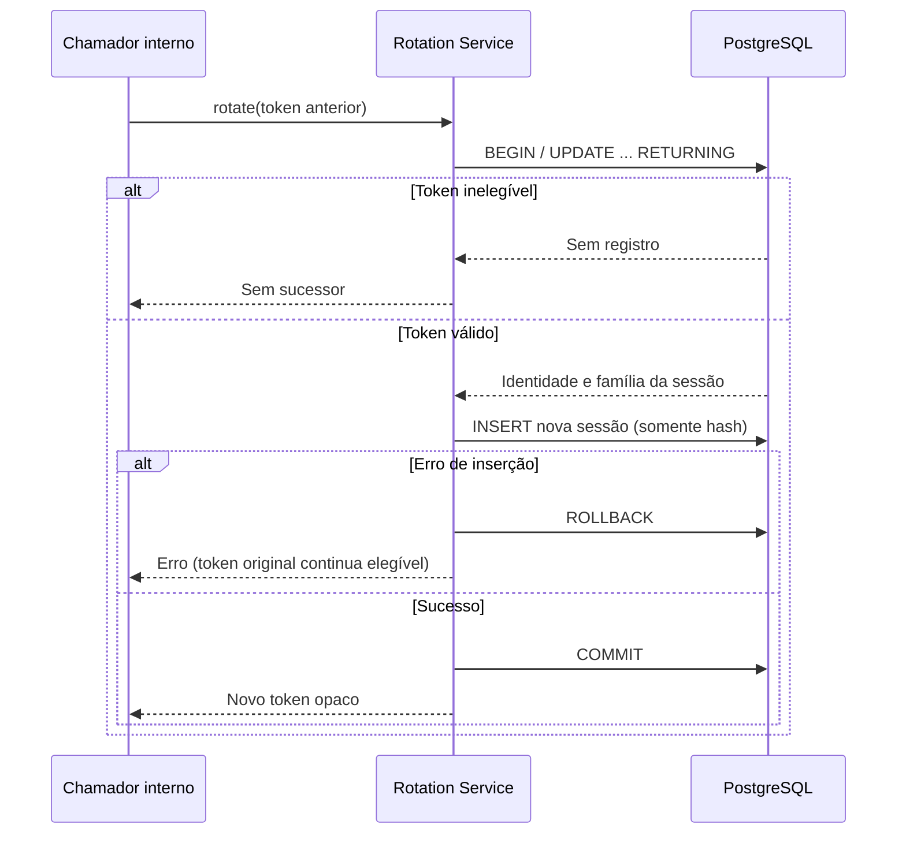

# Persistência de sessões e controle de concorrência

## Estrutura e migração

O User Service utiliza Flyway para versionar a criação de `refresh_sessions` por meio de `V1__create_refresh_sessions.sql`. O projeto mantém suas tabelas legadas sob `ddl-auto: update` e usa baseline 0 para introduzir o histórico Flyway em esquemas pré-existentes. Esta coexistência é **transitória** e exige auditoria e backup antes de migrar um banco persistente.

A tabela contém `id`, `user_id`, `family_id`, `token_fingerprint` (único), `created_at`, `expires_at`, `consumed_at` e `revoked_at`. O relacionamento com usuários não recebe chave estrangeira nesta migração porque o esquema compartilhado ainda é administrado parcialmente pelo Hibernate. O isolamento por serviço e a integridade referencial devem ser revistos em uma migração futura.

## Garantia de consumo único

A operação utiliza atualização condicional em PostgreSQL:

```sql
UPDATE refresh_sessions
SET consumed_at = CURRENT_TIMESTAMP
WHERE token_fingerprint = ?
  AND consumed_at IS NULL
  AND revoked_at IS NULL
  AND expires_at > CURRENT_TIMESTAMP;
```

Se uma requisição modifica **uma linha**, ela consumiu o token. Tentativas posteriores modificam **zero linhas**. O banco arbitra requisições concorrentes por bloqueio da linha e reavaliação do predicado, evitando que duas instâncias consumam o mesmo registro. O relógio do banco determina a expiração.

Uma restrição única sobre `token_fingerprint` evita armazenar dois registros com o mesmo fingerprint; é uma garantia distinta de consumo único.

## Autorização da conta durante a rotação

A operação interna `claimForRotation` consulta `users.enabled` dentro da mesma instrução SQL que consome a sessão. A subconsulta `EXISTS` usa `FOR SHARE` para bloquear a linha do usuário enquanto a transação conclui. Assim, uma desativação ou exclusão concorrente precisa ser serializada com a rotação e não ocorre a emissão de um novo refresh token para uma conta que já esteja desativada no momento da verificação.

Se a conta não existe ou está desativada, nenhuma sessão é consumida e nenhum sucessor é criado. Os testes com PostgreSQL simulam os dois cenários, inclusive a reativação posterior de uma conta cujo token ainda é válido.

Este controle atua **somente na rotação interna**. O método legado `consume` e o Todo Service não passam a realizar introspecção do estado do usuário, e a revogação de JWTs já emitidos continua pendente.

## Evidências de teste

O teste `RefreshSessionStoreTest` inicia PostgreSQL real com Testcontainers, aplica o Flyway e verifica:

- Registro e consulta do fingerprint, sem persistir o token em texto puro.
- Consumo único e rejeição de tentativa repetida.
- Duas tentativas concorrentes, das quais apenas uma deve ter sucesso.
- Bloqueio de sessões expiradas ou revogadas e rejeição de fingerprints duplicados.

```bash
mvn -f packages/user-service/pom.xml -Dtest=RefreshSessionStoreTest test
mvn -f packages/user-service/pom.xml verify
```

Requer um daemon Docker acessível.

## Rotação transacional de sessões

O serviço `RefreshSessionRotationService` agora executa uma transação abrangendo duas operações JDBC:

1. `claimForRotation`: um `UPDATE ... RETURNING` reivindica uma sessão elegível e recupera `user_id`, `family_id` e `expires_at` diretamente do banco. Uma sessão consumida, revogada ou expirada não pode ser reivindicada.
2. `create`: insere o sucessor com novo material aleatório de 256 bits, **somente o hash SHA-256** e a mesma identidade/família e expiração absoluta do antecessor.

Se a inserção do sucessor falhar, a transação desfaz também o consumo do antecessor. Duas tentativas concorrentes sobre o mesmo token não podem confirmar dois sucessores.



Os testes `RefreshSessionStoreTest` cobrem rotação, preservação da família, validade absoluta, concorrência e rollback.

**Limites de consistência e segurança:** a rotação funciona no serviço interno e no banco, mas ainda não é exposta por HTTP. Não existe login com refresh, endpoint de logout, verificação do estado atual da conta durante a rotação ou detecção de reutilização que revogue a família. A reutilização do token consumido é recusada, mas ainda não há uma política de resposta a replay. O refresh token original não é persistido nem registrado em logs; o objeto de resultado oculta o token em sua representação textual.

A implementação atual também não garante resiliência à perda de resposta após o COMMIT: o cliente poderia não receber o sucessor. Esse caso precisa ser considerado junto a idempotência e recuperação do fluxo HTTP.

A migração inicial pode precisar de adequações ao histórico de um ambiente existente. Não alterar uma versão Flyway aplicada em produção; criar uma nova migração e validar uma cópia restaurada do banco.

Veja [REFRESH_TOKEN_DESIGN.md](REFRESH_TOKEN_DESIGN.md), [ADR-0002](ADR-0002-distributed-token-revocation.md) e a [Issue #11](https://github.com/danmaciel/monorepo_sistema_todo_com_microservices/issues/11).
