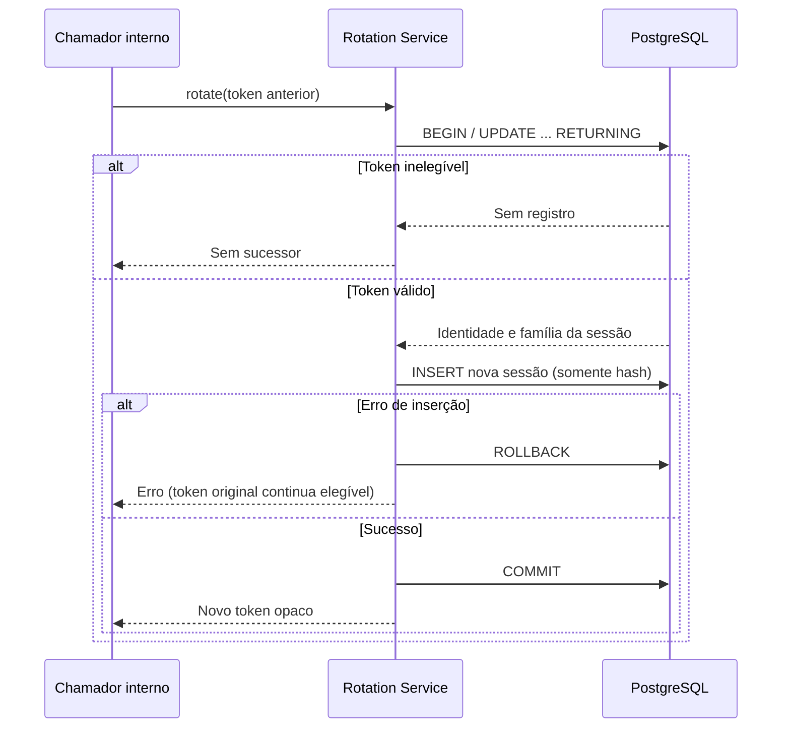
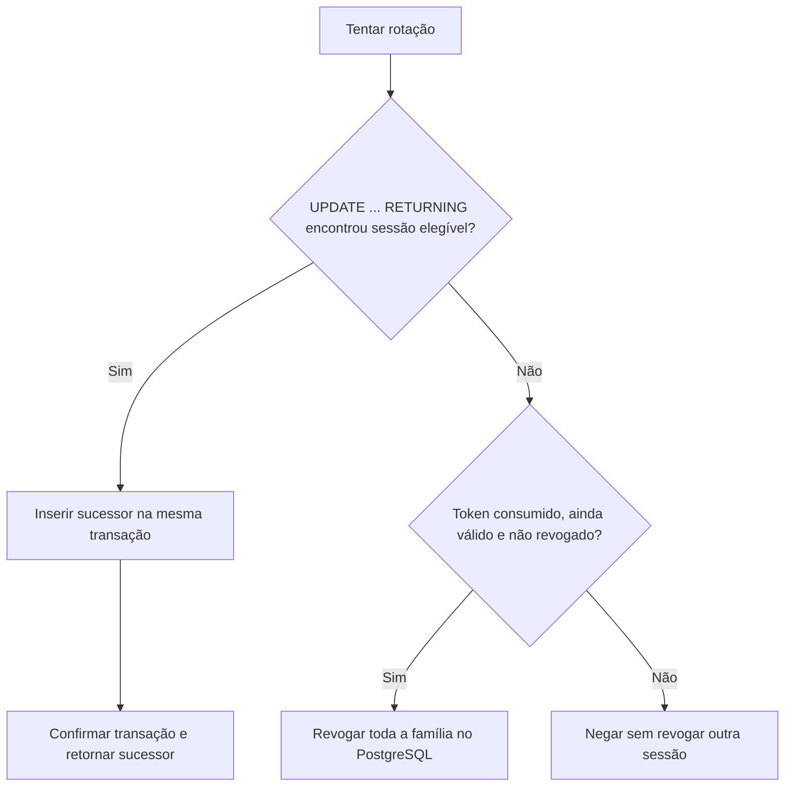

# Persistência de sessões e controle de concorrência

## Estrutura e migração

O User Service utiliza Flyway para versionar a criação de `refresh_sessions` por meio de `V1__create_refresh_sessions.sql`. O projeto mantém suas tabelas legadas sob `ddl-auto: update` e usa baseline 0 para introduzir o histórico Flyway em esquemas pré-existentes. Esta coexistência é **transitória** e exige auditoria e backup antes de migrar um banco persistente.

A tabela contém `id`, `user_id`, `family_id`, `token_fingerprint` (único), `created_at`, `expires_at`, `consumed_at` e `revoked_at`. O relacionamento com usuários não recebe chave estrangeira nesta migração porque o esquema compartilhado ainda é administrado parcialmente pelo Hibernate. O isolamento por serviço e a integridade referencial devem ser revistos em uma migração futura.

## Garantia de consumo único

A operação utiliza atualização condicional em PostgreSQL:

```sql
UPDATE refresh_sessions
SET consumed_at = CURRENT_TIMESTAMP
WHERE token_fingerprint = ?
  AND consumed_at IS NULL
  AND revoked_at IS NULL
  AND expires_at > CURRENT_TIMESTAMP;
```

Se uma requisição modifica **uma linha**, ela consumiu o token. Tentativas posteriores modificam **zero linhas**. O banco arbitra requisições concorrentes por bloqueio da linha e reavaliação do predicado, evitando que duas instâncias consumam o mesmo registro. O relógio do banco determina a expiração.

Uma restrição única sobre `token_fingerprint` evita armazenar dois registros com o mesmo fingerprint; é uma garantia distinta de consumo único.

## Autorização da conta durante a rotação

A operação interna `claimForRotation` consulta `users.enabled` dentro da mesma instrução SQL que consome a sessão. A subconsulta `EXISTS` usa `FOR SHARE` para bloquear a linha do usuário enquanto a transação conclui. Assim, uma desativação ou exclusão concorrente precisa ser serializada com a rotação e não ocorre a emissão de um novo refresh token para uma conta que já esteja desativada no momento da verificação.

Se a conta não existe ou está desativada, nenhuma sessão é consumida e nenhum sucessor é criado. Os testes com PostgreSQL simulam os dois cenários, inclusive a reativação posterior de uma conta cujo token ainda é válido.

Este controle atua **somente na rotação interna**. O método legado `consume` e o Todo Service não passam a realizar introspecção do estado do usuário, e a revogação de JWTs já emitidos continua pendente.

## Evidências de teste

O teste `RefreshSessionStoreTest` inicia PostgreSQL real com Testcontainers, aplica o Flyway e verifica:

- Registro e consulta do fingerprint, sem persistir o token em texto puro.
- Consumo único e rejeição de tentativa repetida.
- Duas tentativas concorrentes, das quais apenas uma deve ter sucesso.
- Bloqueio de sessões expiradas ou revogadas e rejeição de fingerprints duplicados.

```bash
mvn -f packages/user-service/pom.xml -Dtest=RefreshSessionStoreTest test
mvn -f packages/user-service/pom.xml verify
```

Requer um daemon Docker acessível.

## Rotação transacional de sessões

O serviço `RefreshSessionRotationService` agora executa uma transação abrangendo duas operações JDBC:

1. `claimForRotation`: um `UPDATE ... RETURNING` reivindica uma sessão elegível e recupera `user_id`, `family_id` e `expires_at` diretamente do banco. Uma sessão consumida, revogada ou expirada não pode ser reivindicada.
2. `create`: insere o sucessor com novo material aleatório de 256 bits, **somente o hash SHA-256** e a mesma identidade/família e expiração absoluta do antecessor.

Se a inserção do sucessor falhar, a transação desfaz também o consumo do antecessor. Duas tentativas concorrentes sobre o mesmo token não podem confirmar dois sucessores.



Os testes `RefreshSessionStoreTest` cobrem rotação, preservação da família, validade absoluta, concorrência e rollback.

**Limites de consistência e segurança:** a rotação funciona no serviço interno e no banco, mas ainda não é exposta por HTTP. Não existe login com refresh nem endpoint de logout. A verificação de conta ativa e a detecção de reutilização de token consumido foram implementadas no fluxo interno; a coordenação com navegador, renovação e revogação dos JWTs já emitidos permanecem pendentes. O refresh token original não é persistido nem registrado em logs; o objeto de resultado oculta o token em sua representação textual.

A implementação atual também não garante resiliência à perda de resposta após o COMMIT: o cliente poderia não receber o sucessor. Esse caso precisa ser considerado junto a idempotência e recuperação do fluxo HTTP.

A migração inicial pode precisar de adequações ao histórico de um ambiente existente. Não alterar uma versão Flyway aplicada em produção; criar uma nova migração e validar uma cópia restaurada do banco.

Veja [REFRESH_TOKEN_DESIGN.md](REFRESH_TOKEN_DESIGN.md), [ADR-0002](ADR-0002-distributed-token-revocation.md) e a [Issue #11](https://github.com/danmaciel/monorepo_sistema_todo_com_microservices/issues/11).

## Reutilização detectada: revogação da família

Após a tentativa de rotação, caso nenhuma sessão elegível tenha sido reivindicada, o serviço verifica se o token apresentado corresponde a uma sessão **já consumida, ainda dentro de sua validade absoluta e não revogada**. Nesse caso, o PostgreSQL marca como revogados **todos os registros da família**, inclusive eventuais sucessores ainda ativos:

```sql
UPDATE refresh_sessions
SET revoked_at = CURRENT_TIMESTAMP
WHERE family_id = (
    SELECT family_id
    FROM refresh_sessions
    WHERE token_fingerprint = ?
      AND consumed_at IS NOT NULL
      AND revoked_at IS NULL
      AND expires_at > CURRENT_TIMESTAMP
)
AND revoked_at IS NULL;
```

O fingerprint fornecido ao SQL é calculado a partir do segredo apresentado, que **nunca é armazenado em texto puro**. Tokens inexistentes, expirados ou já revogados não acionam essa regra. A invalidação ocorre após a conclusão da transação de rotação, evitando revogar dentro de um fluxo que ainda pode precisar de rollback.



**Trade-off de segurança versus usabilidade:** se uma resposta for perdida após o COMMIT ou duas abas enviarem o mesmo refresh token simultaneamente, a segunda tentativa pode ser interpretada como replay e revogar uma sessão legítima. Esse comportamento `fail-closed` é deliberado nesta etapa. Antes de expor a API, será necessário decidir entre coordenação de renovação no cliente, política de tolerância/idempotência de reenvios e proteção contra o uso de tokens roubados. Uma tolerância ingênua a reuso também pode facilitar ataques.

**Escopo exato:** essa revogação funciona **somente para refresh sessions no User Service**. Não invalida JWTs de acesso já emitidos no Todo Service e não constitui logout remoto ou revogação distribuída completa. A integração HTTP/frontend ainda não existe.


## Revogação interna de uma família apresentada

O repositório implementa `revokeFamilyByPresentedToken`, que recebe um refresh token opaco, calcula seu fingerprint SHA-256 e revoga os **registros já existentes** da família correspondente, desde que o token apresentado ainda esteja dentro da validade e não esteja revogado. Um token desconhecido, expirado ou já revogado não seleciona uma família. Uma segunda chamada não modifica novos registros.

Os testes com PostgreSQL verificam que a operação bloqueia a rotação de um sucessor já criado, é repetível sem efeitos adicionais e não altera famílias independentes.

**Esta operação interna ainda não constitui logout.** Não existe endpoint HTTP, vinculação a um login de navegador, limpeza de cookie, proteção CSRF ou revogação de access JWT. O acesso pela camada de serviço (`RefreshSessionRotationService.revokeFamily`) agora coordena a revogação com a rotação por bloqueio transacional de família; chamadas diretas ao método de repositório fora desse protocolo **não possuem essa garantia**. Antes de expor a operação para clientes, ainda será necessário revisar o contrato HTTP, as perdas de resposta após COMMIT, a concorrência entre abas e as políticas de revogação.

## Serialização de operações da mesma família

A camada interna `RefreshSessionRotationService` adquire, **dentro de uma transação PostgreSQL**, um advisory lock transacional calculado a partir do `family_id` obtido por fingerprint do token apresentado. Rotação, rejeição por replay com revogação e revogação explícita de família devem seguir o mesmo protocolo:

1. Iniciar transação.
2. Resolver a família do token apresentado e adquirir o lock transacional `pg_advisory_xact_lock`.
3. Reavaliar o estado do token no banco e consumir/inserir sucessor ou revogar a família.
4. Confirmar ou desfazer a transação, liberando o bloqueio.

O lock é **compartilhado entre instâncias** que usam o mesmo PostgreSQL, não um `synchronized` limitado ao processo Java. Um hash de 64 bits pode causar colisões, que apenas serializam famílias independentes adicionalmente. Há testes com Testcontainers para ambas as ordens: rotação iniciada antes da revogação e revogação iniciada antes da rotação. Eles verificam que não sobra sucessor utilizável no primeiro caso e que nenhum sucessor é emitido após revogação no segundo.

**Escopo exato da garantia:** a serialização vale para os métodos da camada de serviço que respeitam esse protocolo e para instâncias conectadas ao mesmo banco. Métodos de repositório chamados diretamente, escritas de outros processos que ignorem o lock ou alterações de esquema fora desse fluxo não compartilham a garantia. Nenhuma revogação imediata de access JWT foi adicionada. A operação ainda não foi integrada ao login, frontend, refresh HTTP ou logout HTTP.


## Emissão inicial interna de refresh session

O serviço `RefreshSessionIssuanceService` cria uma primeira sessão para um `user_id` existente e habilitado. A validade absoluta é configurável em `jwt.refresh-session-lifetime-seconds` (padrão demonstrativo de 604800 segundos, ou sete dias). Essa duração **não altera** a validade atual de 24 horas dos access JWTs.

O token opaco é gerado com `SecureRandom`; apenas seu fingerprint SHA-256 entra na tabela `refresh_sessions`. Uma instrução `INSERT ... SELECT` verifica `users.enabled = TRUE` e bloqueia a linha do usuário com `FOR SHARE` durante a inserção. Uma conta inexistente ou desabilitada não recebe sessão. O resultado interno protege o valor do token contra sua inclusão acidental no `toString()`.

Os testes `RefreshSessionStoreTest` em PostgreSQL cobrem emissão para usuário habilitado, ausência de token para contas desabilitadas/inexistentes e rotação subsequente. `RefreshSessionIssuanceServiceTest` cobre tratamento de duração inválida e representação textual sem o segredo.

**Limitação decisiva:** essa emissão ainda **não é chamada pelo login**. Não foram criados endpoints de refresh/logout, cookies, configuração de CSRF nem renovação pelo frontend. O prazo de sete dias descreve apenas a configuração do serviço interno, não uma sessão web ativa. Antes da integração HTTP, é necessário definir o contrato e testes de falhas de rede, concorrência entre abas, proteção CSRF e lançamento compatível.
