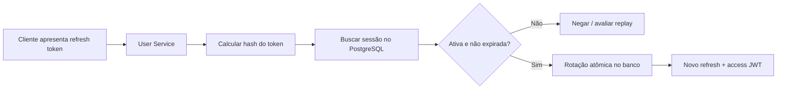

# Laboratório — modelo de refresh token (etapa 1)

**Estado:** modelo e testes unitários, **não integrado ao login**. Esta etapa não oferece renovação de sessão ao navegador.

## O problema

Um JWT de acesso é normalmente auto-contido: o Todo Service pode conferir sua assinatura e expiração sem consultar o User Service. Isso melhora a disponibilidade, mas um token emitido permanece válido até vencer, mesmo após logout, a menos que exista um mecanismo adicional de revogação.

A estratégia proposta no [ADR-0002](ADR-0002-distributed-token-revocation.md) é combinar access tokens curtos com **refresh tokens opacos**, controlados pelo User Service. Este documento descreve somente os fundamentos antes de integrar banco e API.

## Componentes desta entrega

| Classe | Responsabilidade | Não faz |
| --- | --- | --- |
| `RefreshTokenMaterial` | Gera 32 bytes aleatórios via `SecureRandom`, codifica em Base64URL sem padding e gera impressão digital SHA-256 | Não persiste token, não faz refresh e não revoga sessões |
| `RefreshSession` | Carrega `id`, `userId`, `familyId`, fingerprint, expiração e data de revogação; verifica atividade em um instante | Não é entidade JPA, não fornece bloqueio transacional ou detecção de replay |
| `RefreshSessionTest` | Verifica comprimento do material, hashes, comparação, expiração e revogação | Não demonstra comportamento sob concorrência nem com PostgreSQL |

## Por que o banco armazena o hash, e não o token?

Imagine o token como uma senha de uso único. Quem apresenta o valor original pode solicitar renovação, portanto ele é um **segredo de autenticação**. Se o banco vazar, armazenar apenas a impressão digital dificulta o uso direto dos tokens roubados. SHA-256 é apropriado como fingerprint para tokens com **alta entropia gerados aleatoriamente**; não use essa justificativa para senhas humanas, que exigem hash lento (Argon2id/bcrypt/scrypt).

O código usa `MessageDigest.isEqual` para comparar fingerprints. Isso reduz diferenças de tempo na comparação, mas não substitui limitação de tentativas, TLS, registro de incidentes ou desenho de sessão seguro.

## O que falta para funcionar de verdade?



**As etapas de busca no banco, rotação e emissão do novo token não foram implementadas.** A futura rotação deverá ocorrer em uma transação com controle de concorrência ou atualização condicional: duas requisições simultâneas não podem consumir o mesmo token com sucesso.

A identificação de `familyId` permitirá invalidar a família após reutilização suspeita. A regra de replay (inclusive tratamento de falhas de rede, corrida entre abas e reenvio legítimo) ainda precisa ser projetada e testada.

## Teste no seu ambiente

```bash
mvn -f packages/user-service/pom.xml -Dtest=RefreshSessionTest test
mvn -f packages/user-service/pom.xml verify
```

Faça três exercícios sem consultar a implementação:

1. Explique a diferença entre **access token JWT** e **refresh token opaco**, incluindo quem os valida.
2. Desenhe como duas requisições concorrentes tentariam usar o mesmo refresh token. Onde colocar a garantia de uso único?
3. Explique por que um hash SHA-256 é aceitável aqui, mas não seria suficiente para uma senha curta escolhida por um usuário.

Ao explicar em uma entrevista, use formulação fiel: *“Modelei o material criptográfico e os invariantes de uma sessão de refresh token e escrevi testes unitários. A persistência e a rotação transacional ainda são etapas seguintes.”*

## Próxima entrega sugerida

Criar tabela de sessões por **migração versionada** no PostgreSQL, mapear a entidade de persistência separadamente da classe de domínio e escrever testes de integração que comprovem atomicidade, revogação da família e rejeição de replay. Não reduzir o prazo do JWT atual de 24 horas até que a renovação completa tenha sido validada.
