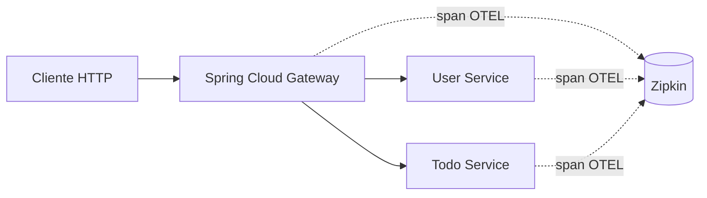

# Tracing distribuído (ambiente de demonstração)

Esta configuração acrescenta **Micrometer Tracing + OpenTelemetry** aos componentes Spring Boot **API Gateway**, **User Service** e **Todo Service**, exportando spans para o **Zipkin** local.

## Como executar

1. Copie `.env.example` para `.env`, preenchendo as credenciais locais com valores aleatórios fortes.
2. Execute `docker compose up --build -d postgres zipkin eureka user-service todo-service gateway`.
3. Abra [Zipkin local](http://localhost:9411) e realize requisições através de `http://localhost:8080/api/users/**` e `http://localhost:8080/api/todos/**`.
4. Na interface Zipkin, pesquise pelas aplicações `api-gateway`, `user-service` e `todo-service`.

A porta 9411 está vinculada somente ao endereço `127.0.0.1` da máquina host. O backend Zipkin é de **desenvolvimento**, sem autenticação, retenção durável ou proteção para uso público.

## Verificação automatizada

A pipeline [Docker Compose E2E](../.github/workflows/e2e.yml) executa o fluxo real de registro/login e operações de tarefas pelo Gateway. Depois, `scripts/verify_traces.py` consulta a API de serviços do Zipkin para comprovar que cada um dos três componentes exportou spans. Este check demonstra **exportação de spans**, mas não valida sozinho toda a propagação de contexto entre serviços.

Os logs Java no perfil Docker incluem `traceId` e `spanId` para facilitar a correlação com os rastros.

## Decisões e limitações

- O projeto está na linha **Spring Boot 3.5.x**, que aceita a integração Micrometer/OpenTelemetry e o exporter Zipkin. O suporte OTel→Zipkin está sendo descontinuado nas linhas mais recentes; uma evolução futura deverá considerar **OTLP + OpenTelemetry Collector / Tempo ou Jaeger**.
- O sampling está em **100% apenas no perfil Docker de demonstração**. Em produção, reduzir a taxa, evitar dados pessoais em atributos e controlar custos/retenção.
- Os serviços ainda usam um PostgreSQL compartilhado; a solução atual não cobre dependências de mensageria ou tracing assíncrono.
- O Zipkin e a pipeline não demonstram SLO, alertas, métricas centralizadas, correlação de logs em agregador ou HA do backend de tracing.
- Se houver problemas de exportação, conferir variáveis `ZIPKIN_ENDPOINT`, conectividade `zipkin:9411` na rede do Compose e as logs dos três serviços.

## Referências

- [Documentação oficial Spring Boot 3.5 — Tracing](https://docs.spring.io/spring-boot/3.5/reference/actuator/tracing.html)
- [Modelo arquitetural geral](ARCHITECTURE.md)
